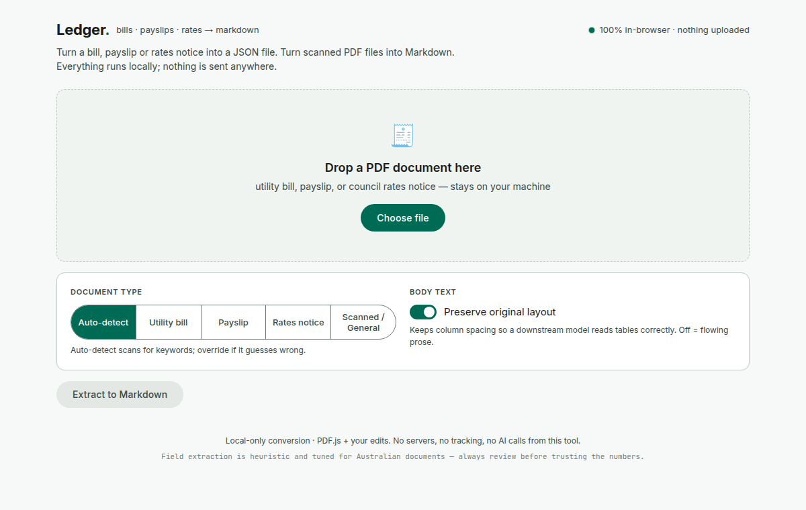

  

# Ledger — PDF to Markdown / JSON Conversion

A local-only, browser-based tool that converts Australian utility bills, payslips, and council rates notices into clean Markdown notes and/or JSON files with structured YAML front-matter — ready to interrogate with AI. It also converts any other PDF — including scanned or photographed documents — into readable Markdown, which saves token usage when seeking AI assistance.

**Nothing is uploaded. Everything runs in your browser.**

---

## What it does

Drop a PDF onto the page and Ledger reconstructs the text as clean Markdown. For recognised document types it also extracts the key fields into a labelled front-matter header. It outputs two formats:

- **Markdown (`.md`)** — for Obsidian, Apple Notes, or any Markdown-based workflow
- **JSON (`.json`)** — structured for direct import into notes apps that store content in a database, with a compact summary line positioned so AI assistants can read all key figures within their per-note preview limit
- **Ledger** handles the extraction step only — AI querying happens with your AI assistant of choice, using the structured output as its source material

---

## Supported document types

Auto-detected by keyword scoring, or set manually with the type buttons:

| Type | Extracted fields |
|---|---|
| **Utility bill** | Provider, account, meter ID (NMI/MIRN/serial), period, usage with unit (kWh/MJ/kL), avg daily usage, amount due, due date |
| **Payslip** | Employer, pay period, pay date, gross, tax, super guarantee, salary sacrifice super, net, YTD gross |
| **Rates notice** | Council, assessment number, financial year, capital improved value, rateable value, amount due, due date |
| **Scanned / General** | For any PDF you just want as readable Markdown — a report, a letter, an interview transcript, or a scanned/photographed document. Text is reconstructed into flowing paragraphs; image-only files are read with OCR. Minimal field extraction (date only). |

If auto-detect can't confidently match one of the structured types, it falls back to a generic document (date + amount). Structured-type detection is tuned for Australian providers, councils, and terminology (NMI, PAYG, SG, kilolitre, etc.).

---

## Output formatting

Two ways of laying out the reconstructed text:

- **Flowing paragraphs (default for Scanned / General and any OCR'd document)** — wrapped lines are merged back into paragraphs, so prose and transcripts read naturally
- **Preserve original layout (default for structured bills/payslips/rates read from a native text layer)** — keeps column spacing so tabular figures line up

The "Preserve original layout" toggle controls this for the structured types. Scanned, general, and OCR'd documents always use flowing paragraphs, because column-padding logic collapses word spacing on OCR output.

---

## How to use

1. Save `index.html` to your machine (keep `sw.js` alongside it if you want offline/PWA support)
2. Open it in any modern browser — no server, no install
3. Drop or choose a PDF
4. Pick a type if auto-detect guesses wrong
5. Review and correct the extracted fields
6. Download `.md`, `.json`, or copy the Markdown to clipboard

Keep a copy on each machine you use. There is no hosted version — though if you host `index.html` yourself over http/https (with `sw.js` alongside it), your browser will offer to install it as an app with offline support.

---

## Features

- **100% local** — PDF.js runs entirely in-browser; no file ever leaves your machine
- **Auto-detection** — weighted keyword scoring identifies document type
- **Readable reconstruction** — wrapped lines are rejoined into paragraphs for prose, with an optional layout-preserving mode for tabular documents
- **Heading detection** — font size metadata promotes section headers to Markdown `##`
- **Text normalisation** — ligatures (`fi→fi`), smart quotes, en/em dashes, non-breaking spaces cleaned automatically
- **OCR for scanned PDFs** — if a PDF has no text layer (scanned or photographed), Tesseract.js is loaded on demand and run over every page, word by word, with grayscale/contrast pre-processing for cleaner reads; results are flagged with an "OCR'd" badge since accuracy is lower than a native text layer
- **Editable front-matter** — review and correct any field before export; add custom fields
- **JSON export** — summary line placed at the top of note content so AI assistants see all key figures within their context preview window
- **Installable** — if you host the file over http/https (rather than opening it as a local file), it's an installable PWA with offline support after first load

---

## Modifications from LiteDoc

This tool began as a fork of [LiteDoc](https://github.com/0xovo/LiteDoc) by [0xovo](https://github.com/0xovo) and has been substantially modified:

- **Domain-specific extraction** — heuristic field extraction for Australian utility bills, payslips, and council rates notices, with weighted keyword detection and regex patterns tuned to local providers and terminology
- **JSON export** — structured output for notes apps with a compact summary line optimised for AI context windows
- **Material Design 3 UI** — restyled with Inter + JetBrains Mono, MD3 tonal colour system, pill buttons, underline tabs, and tonal surface hierarchy; warm editorial aesthetic replaced with a clean productivity-tool look
- **Paragraph reconstruction** — wrapped lines are merged back into flowing paragraphs so prose and transcripts read naturally, with a layout-preserving mode retained for tabular documents
- **Font size–based heading detection** — items significantly above the page median font size are promoted to `##` headings
- **Word-level OCR** — the Tesseract.js path rasterises every page (with grayscale/contrast pre-processing), recognises word by word, and rebuilds line/paragraph structure from word bounding boxes; the worker is recycled periodically to keep memory in check
- **Text normalisation pass** — ligature and encoding artefact cleanup applied to every extracted text item
- **Separate super fields** — super guarantee and salary sacrifice are extracted into distinct fields with correctly prioritised label matching
- **Installable PWA shell** — icons and a service worker (`sw.js`) that pre-caches the app shell and CDN libraries for offline use

---

## Dependencies (all CDN, no install)

- [PDF.js](https://mozilla.github.io/pdf.js/) — PDF parsing (Mozilla, Apache 2.0)
- [Tesseract.js](https://tesseract.projectnaptha.com/) — OCR, loaded only when a scanned PDF is detected (Apache 2.0)
- [Inter](https://rsms.me/inter/) — UI font (SIL Open Font Licence)
- [JetBrains Mono](https://www.jetbrains.com/legalforms/fonts/) — monospace font (SIL Open Font Licence)

---

## Notes

- Field extraction is heuristic — always review the front-matter before trusting numbers
- Scanned (image-only) PDFs are read via on-demand OCR, which needs network access on first use and is noticeably slower and less accurate than a native text layer — double-check every field, especially names and figures
- For difficult historical or handwritten scans, a vision-capable AI model reading a page image will usually out-read the built-in OCR; Ledger's OCR is a convenient local fallback, not a specialist handwriting engine
- Tuned for Australian documents; results will vary for non-AU formats
- The original PDF remains your legal record — the extracted note is a working copy for search and AI queries
