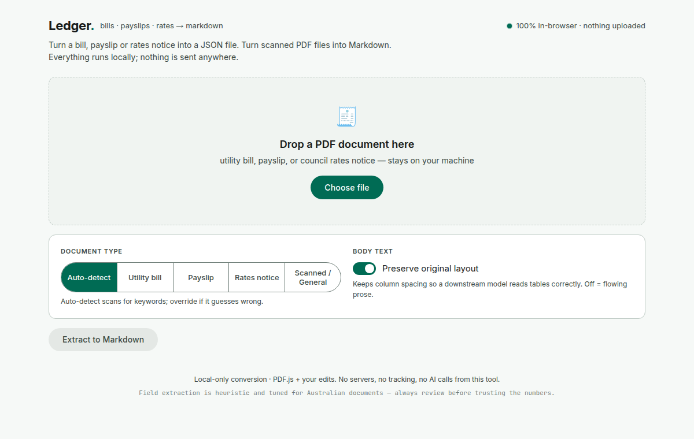

  

# Ledger — PDF to Markdown / JSON Conversion

A local-only, browser-based tool that converts Australian utility bills, payslips, council rates notices and receipts — as PDFs or phone photos — into clean Markdown notes and/or JSON files with structured YAML front-matter, ready to interrogate with AI.

For general PDFs (reports, letters, transcripts, long documents) use [pdftext](https://github.com/firehorse67/pdftext), which has the fuller text reconstruction, tables, chunking and batch tools. Ledger stays focused on pulling the key figures out of household paperwork.

**Nothing is uploaded. Everything runs in your browser.**

---

## What it does

Drop a PDF or photo onto the page and Ledger reconstructs the text as clean Markdown. For recognised document types it also extracts the key fields into a labelled front-matter header. It outputs two formats:

- **Markdown (`.md`)** — for Obsidian, Apple Notes, or any Markdown-based workflow
- **JSON (`.json`)** — structured for direct import into notes apps that store content in a database, with a compact summary line positioned so AI assistants can read all key figures within their per-note preview limit
- **Ledger** handles the extraction step only — AI querying happens with your AI assistant of choice, using the structured output as its source material

---

## Supported document types

Auto-detected by keyword scoring, or set manually with the type buttons:

| Type | Extracted fields |
|---|---|
| **Utility bill** | Provider, account, meter ID (NMI/MIRN/serial), period, usage with unit (kWh/MJ/kL), avg daily usage, amount due, due date |
| **Payslip** | Employer, pay period, pay date, gross, tax, super guarantee, salary sacrifice super, net, YTD gross |
| **Rates notice** | Council, assessment number, financial year, capital improved value, rateable value, amount due, due date |
| **Receipt** | Merchant, ABN, date, total, GST, payment method (EFTPOS, card type, cash, Apple/Google Pay) |

If auto-detect can't confidently match one of these types, it falls back to a generic document (date + amount) and suggests pdftext. Structured-type detection is tuned for Australian providers, councils, and terminology (NMI, PAYG, SG, kilolitre, etc.).

---

## Output formatting

Two ways of laying out the reconstructed text:

- **Preserve original layout (default for documents read from a native text layer)** — keeps column spacing so tabular figures line up
- **Flowing paragraphs (always used for photos and OCR'd PDFs)** — wrapped lines are merged back into paragraphs

The "Preserve original layout" toggle controls this for native-text PDFs. Photos and OCR'd documents always use flowing paragraphs, because column-padding logic collapses word spacing on OCR output. The JSON export always uses flowing paragraphs.

---

## How to use

1. Save `index.html` to your machine (keep `sw.js` alongside it if you want offline/PWA support)
2. Open it in any modern browser — no server, no install
3. Drop or choose a PDF, or a photo of a receipt or bill (JPG, PNG, WebP; HEIC in Safari)
4. Pick a type if auto-detect guesses wrong
5. Review and correct the extracted fields
6. Download `.md`, `.json`, or copy the Markdown to clipboard

Keep a copy on each machine you use. There is no hosted version — though if you host `index.html` yourself over http/https (with `sw.js` alongside it), your browser will offer to install it as an app with offline support.

---

## Features

- **100% local & private** — PDF.js runs entirely in-browser; no file or document text is ever uploaded or sent anywhere.
- **Sensitive document security** — ideal for processing confidential documents (utility bills, payslips, rates notices, receipts) with full client-side privacy guarantees.
- **Auto-detection** — weighted keyword scoring identifies document type
- **Readable reconstruction** — wrapped lines are rejoined into paragraphs for prose, with an optional layout-preserving mode for tabular documents
- **Heading detection** — font size metadata promotes section headers to Markdown `##`
- **Text normalisation** — ligatures (`fi→fi`), smart quotes, en/em dashes, non-breaking spaces cleaned automatically
- **Photos and scanned PDFs** — photos, and PDFs with no text layer, are read with Tesseract.js, loaded on demand. A page that reads poorly (mean word confidence under 80%) is retried once on a sharpened, adaptively thresholded copy and the better read is kept, which helps with faded thermal receipts and uneven phone lighting. Results carry an "OCR'd" badge with the confidence score, since accuracy is lower than a native text layer
- **Password-protected PDFs** — encrypted payslips and statements are unlocked locally; the password is typed into the page, used only by PDF.js in memory, and never stored
- **Editable front-matter** — review and correct any field before export; add custom fields
- **Learns each supplier's layout** — when you correct a field (or add one, such as an order number) and export, Ledger notes the label printed beside that value and saves it for that supplier, keyed by ABN and name. The next document from the same supplier fills those fields automatically, marked "learned". Rules live only in this browser's local storage; "Forget" in the field panel clears a supplier
- **Best-guess flags** — values that came from a last-resort rule (an unlabelled date, the first name-like line) get a dashed outline and a "best guess" tag, so you know what to check first
- **GST check for receipts** — the GST field shows what 1/11 of the total would be, and flags a GST figure larger than that
- **JSON export** — summary line placed at the top of note content so AI assistants see all key figures within their context preview window
- **Installable** — if you host the file over http/https (rather than opening it as a local file), it's an installable PWA with offline support after first load

---

## Modifications from LiteDoc

This tool began as a fork of [LiteDoc](https://github.com/0xovo/LiteDoc) by [0xovo](https://github.com/0xovo) and has been substantially modified:

- **Domain-specific extraction** — heuristic field extraction for Australian utility bills, payslips, council rates notices and receipts, with weighted keyword detection and regex patterns tuned to local providers and terminology
- **JSON export** — structured output for notes apps with a compact summary line optimised for AI context windows
- **Material Design 3 UI** — restyled with Inter + JetBrains Mono, MD3 tonal colour system, pill buttons, underline tabs, and tonal surface hierarchy; warm editorial aesthetic replaced with a clean productivity-tool look
- **Paragraph reconstruction** — wrapped lines are merged back into flowing paragraphs so prose and transcripts read naturally, with a layout-preserving mode retained for tabular documents
- **Font size–based heading detection** — items significantly above the page median font size are promoted to `##` headings
- **Word-level OCR** — the Tesseract.js path reads photos directly and rasterises PDF pages one at a time, retries low-confidence pages on an adaptive-threshold variant, recognises word by word, and rebuilds line/paragraph structure from word bounding boxes; the worker is recycled periodically to keep memory in check
- **Text normalisation pass** — ligature and encoding artefact cleanup applied to every extracted text item
- **Separate super fields** — super guarantee and salary sacrifice are extracted into distinct fields with correctly prioritised label matching
- **Installable PWA shell** — icons and a service worker (`sw.js`) that pre-caches the app shell and CDN libraries for offline use

---

## Dependencies (all CDN, no install)

- [PDF.js](https://mozilla.github.io/pdf.js/) — PDF parsing (Mozilla, Apache 2.0)
- [PDF.js data files](https://www.npmjs.com/package/pdfjs-dist) — image decoders (JPEG 2000, JBIG2), character maps and standard fonts, fetched from jsdelivr only when a PDF needs them
- [Tesseract.js](https://tesseract.projectnaptha.com/) — OCR, loaded only for photos and scanned PDFs (Apache 2.0)
- [Inter](https://rsms.me/inter/) — UI font (SIL Open Font Licence)
- [JetBrains Mono](https://www.jetbrains.com/legalforms/fonts/) — monospace font (SIL Open Font Licence)

---

## Notes

- Field extraction is heuristic — always review the front-matter before trusting numbers
- Learned layouts are stored per browser, so each machine (and each browser) learns separately; clearing site data clears them
- Photos and scanned (image-only) PDFs are read via on-demand OCR, which needs network access on first use and is noticeably slower and less accurate than a native text layer — double-check every field, especially names and figures
- For difficult historical or handwritten scans, a vision-capable AI model reading a page image will usually out-read the built-in OCR; Ledger's OCR is a convenient local fallback, not a specialist handwriting engine
- Tuned for Australian documents; results will vary for non-AU formats
- The original PDF remains your legal record — the extracted note is a working copy for search and AI queries
